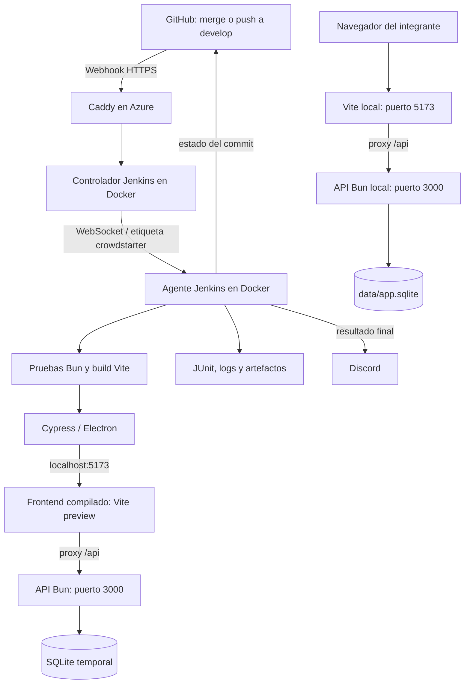

# Entrega 2 — CrowdStarter

## 1. Objetivo

Automatizar la integración del proyecto para que cada cambio incorporado a `develop` se compruebe mediante pruebas y compilación. Centralizar los resultados en Jenkins, asociarlos al commit evaluado en GitHub y notificar al equipo en Discord.

La entrega incorpora dos requerimientos: gestión de perfil (HU-09) y campañas favoritas (HU-10). El pipeline implementa integración continua y conserva el frontend compilado para su distribución; no realiza un despliegue público permanente de la aplicación.

## 2. Trabajo implementado

- Jenkins instalado en una máquina virtual de Azure, con controlador y agente separados en Docker.
- Acceso HTTPS mediante Caddy y un subdominio DuckDNS.
- Webhook de GitHub que solicita comprobar cambios en `develop`.
- Pipeline versionado en [Jenkinsfile](../Jenkinsfile): dependencias, pruebas Bun, compilación y Cypress.
- Reportes JUnit, logs y artefactos; publicación del estado del commit en GitHub.
- Notificación final en Discord mediante un webhook guardado en Jenkins.
- [HU-09: gestión del perfil](../HU-09.md).
- [HU-10: campañas favoritas](../HU-10.md).

## 3. Arquitectura e infraestructura

### Aplicación

En el entorno local, el navegador carga el frontend Vue desde Vite en `http://localhost:5173`. Las solicitudes `/api` pasan por el proxy de Vite hacia la API Bun, que escucha en `127.0.0.1:3000`. La API utiliza SQLite mediante `bun:sqlite`; no necesita un servidor de base de datos independiente.

Por defecto, los datos se conservan en `data/app.sqlite`. La variable `DATABASE_PATH` permite usar otro archivo. `APP_ORIGIN` define el origen autorizado para las operaciones que modifican datos y `PORT` permite cambiar el puerto de la API. Los valores predeterminados coinciden con las URLs anteriores.

### Jenkins y entorno de pruebas

Jenkins corre en la VM `vm-jenkins` de Azure: Ubuntu Server 24.04 LTS, región North Central US, tamaño B2als_v2 (2 CPU y 4 GB RAM). El controlador Docker usa `jenkins/jenkins:lts-jdk21`, volumen persistente `jenkins_home` y cero ejecutores. El agente `crowdstarter-agent` usa la etiqueta `crowdstarter`, un ejecutor y conexión WebSocket.

Caddy recibe tráfico HTTP/HTTPS y administra el certificado TLS. El puerto 8080 del controlador se publica únicamente en loopback; el acceso web público usa 80 y 443. SSH está limitado a la IP del administrador y requiere clave privada.

Durante Cypress, el agente levanta la API y el frontend compilado con Vite preview. Ambos corren dentro del entorno del agente; el navegador Electron de Cypress los consulta por localhost. SQLite utiliza un archivo temporal independiente de los datos locales de los integrantes. Al terminar, el script detiene ambos servicios y elimina la base temporal.



### Dependencias entre la herramienta y la aplicación

| Componente | Dependencia y función |
|---|---|
| Vue y Vite | Renderizan la interfaz y generan `dist/`. |
| Bun | Instala dependencias, ejecuta la API y las pruebas Bun. |
| SQLite | Guarda usuarios, sesiones, campañas, aportes y favoritas. |
| Cypress y Electron | Ejecutan pruebas E2E contra frontend y API reales. |
| Node.js | Ejecuta los scripts de estados GitHub y notificaciones Discord en Jenkins. |
| Bash y curl | Orquestan y comprueban los servicios temporales de E2E. |
| Git | Obtiene el código y el SHA exacto evaluado. |
| Jenkins y sus complementos | Ejecutan el pipeline, gestionan credenciales y publican reportes. |

Las versiones registradas del agente y su operación se detallan en [CI-CD.md](CI-CD.md).

## 4. Pipeline de integración continua

La tarea `crowdstarter-ci` obtiene su definición del repositorio, con rama `*/develop` y archivo `Jenkinsfile`. Un merge produce un push en esa rama. El webhook notifica a Jenkins, que comprueba cambios en la rama configurada. Abrir una PR por sí solo no ejecuta una validación de esa PR: la tarea no es multibranch.

| Orden | Etapa o acción | Resultado |
|---|---|---|
| 1 | Obtener código | Limpia el workspace y realiza `checkout scm`. |
| 2 | Estado pendiente | Publica `pending` en GitHub para el SHA obtenido. |
| 3 | Dependencias | Ejecuta `bun install --frozen-lockfile`. |
| 4 | Pruebas Bun | Ejecuta la suite y genera `reports/bun.xml`. |
| 5 | Build | Genera el frontend compilado en `dist/`. |
| 6 | Preparar Cypress | Instala y verifica su binario y muestra la versión. |
| 7 | E2E | Ejecuta [ci-e2e.sh](../scripts/ci-e2e.sh), con servicios y SQLite temporales. |
| 8 | Publicación | Procesa JUnit y conserva logs, capturas y videos disponibles. |
| 9 | Artefacto compilado | Conserva `dist/` cuando la ejecución termina correctamente. |
| 10 | Comunicación | Publica el estado final en GitHub y notifica a Discord. |

El pipeline bloquea ejecuciones concurrentes de la tarea y tiene un límite de 25 minutos. Conserva 15 ejecuciones y los artefactos de las 5 más recientes. Una etapa fallida impide continuar normalmente con las siguientes; las acciones finales recopilan los resultados disponibles.

## 5. Integraciones

### GitHub ↔ Jenkins

El webhook de eventos push apunta a:

`https://crowdstarter-jenkins.duckdns.org/github-webhook/`

Jenkins valida el secreto compartido. El script [github-status.mjs](../scripts/github-status.mjs) publica estados con el contexto `ci/jenkins/crowdstarter` y un enlace a la ejecución. Obtiene el SHA con Git para identificar el código realmente probado.

### Jenkins → Discord

[notify-discord.mjs](../scripts/notify-discord.mjs) informa resultado, nombre y número del trabajo, commit y enlace. El aviso se envía al finalizar. Si una notificación falla, queda registrado y puede marcar una ejecución exitosa como inestable.

El equipo confirmó que está permitido utilizar Discord en lugar de Slack para esta entrega.

Las credenciales permanecen en Jenkins; el código solo referencia sus identificadores. No se publican tokens, URLs privadas de webhooks ni claves SSH.

## 6. Cómo ejecutar y verificar

### Aplicación y pruebas locales

Instalar Bun compatible con el proyecto (versión comprobada: 1.4.2). Desde la raíz:

```powershell
bun install --frozen-lockfile
bun run dev:server
```

En otra terminal:

```powershell
bun run dev
```

Abrir `http://localhost:5173`. Para comprobar el código:

```powershell
bun test
bun run build
```

Con API y frontend disponibles, ejecutar `bun run test:e2e`. Estas pruebas crean y modifican cuentas y campañas: para repetirlas de forma aislada, seguir el procedimiento con base temporal de [CI-CD.md](CI-CD.md#ejecución-e2e-local-con-base-temporal).

### Jenkins

Abrir [crowdstarter-ci](https://crowdstarter-jenkins.duckdns.org/job/crowdstarter-ci/) con una cuenta autorizada. Si la VM está desasignada, iniciarla y verificar que el agente esté conectado. Para una ejecución manual, pulsar **Construir ahora**.

### Verificación del webhook

1. Integrar una PR real y revisada hacia `develop`.
2. No pulsar **Construir ahora**.
3. Comprobar que aparece una nueva ejecución y que su causa corresponde a GitHub.
4. Comparar el SHA de la consola con el commit integrado.
5. Comprobar pruebas, compilación, artefactos, estado de GitHub y aviso en Discord.
6. Si no inicia, revisar las entregas recientes del webhook en GitHub y la rama configurada en Jenkins.

El equipo confirmó este flujo tras integrar la PR #5. La evidencia se referencia en el [índice de evidencias](evidencias/entrega-2/README.md).

## 7. Mejoras de la aplicación

| Historia | Funcionalidad | Ubicación |
|---|---|---|
| [HU-09](../HU-09.md) | Consultar y editar nombre/correo, cambiar contraseña y eliminar la cuenta con confirmación y restricciones. | Menú **Mi perfil**, ruta `#/profile`; API `/api/profile`. |
| [HU-10](../HU-10.md) | Guardar/quitar campañas activas y consultar una selección privada persistente. | Detalle de campaña y menú **Mis favoritas**, ruta `#/favorites`; API `/api/favorites`. |

La eliminación de cuenta conserva los aportes mediante anonimización e invalida sus sesiones. Las favoritas se relacionan por usuario y campaña sin duplicados; las campañas canceladas se ocultan a otros usuarios.

## 8. Pruebas y relación con CI

La revisión local del commit `c684be0`, posteriormente integrado mediante la PR #5, obtuvo:

| Verificación | Resultado |
|---|---|
| Bun | 137 aprobadas, 0 fallidas; 851 expectativas en 13 archivos. |
| Build Vite | Completado correctamente. |
| Cypress HU-05 | 6 escenarios aprobados. |
| Cypress HU-09 | 4 escenarios aprobados. |
| Cypress HU-10 | 4 escenarios aprobados. |
| Total Cypress | 14 aprobados, 0 fallidos. |

Bun cubre autenticación, validaciones, API, persistencia, lógica de componentes y el helper de autenticación E2E. Cypress comprueba flujos completos de edición de campañas, perfil y favoritas. Estos escenarios no constituyen cobertura E2E de todas las funcionalidades.

La PR #5 se integró en `develop` mediante `15613b603612cdfce45821b20840aa4b1e01c31c`. El equipo confirmó la ejecución automática y exitosa [Jenkins #10](https://crowdstarter-jenkins.duckdns.org/job/crowdstarter-ci/10/), el estado de GitHub y la notificación de Discord. El acceso al pipeline requiere autorización. El repositorio incluye seis capturas PNG y dos impresiones PDF revisadas, incluido el resumen Cypress y su transcripción legible. Consultar el índice para el alcance de cada evidencia.

Resultado esperado: Jenkins **SUCCESS**, estado GitHub `success` y aviso de éxito en Discord. Pruebas o compilación fallidas deben dejar visible el fallo. Los errores de integración pueden producir un estado inestable; no equivalen a una validación exitosa.

## 9. Evidencias

Consultar el [índice de evidencias](evidencias/entrega-2/README.md), que distingue resultados locales, confirmación del equipo y archivos revisados.

- [PR #3: perfil](https://github.com/EstebanBecerraC/Proyecto_pds/pull/3).
- [PR #4: Cypress de perfil](https://github.com/EstebanBecerraC/Proyecto_pds/pull/4).
- [PR #5: favoritas](https://github.com/EstebanBecerraC/Proyecto_pds/pull/5).
- [Jenkins #10: validación posterior al merge](https://crowdstarter-jenkins.duckdns.org/job/crowdstarter-ci/10/) — requiere autenticación.

## 10. Preparación de la release 2

Las notas están preparadas en [RELEASE-2.md](RELEASE-2.md) y los cambios resumidos en [CHANGELOG.md](../CHANGELOG.md). La release aún no está publicada.

Antes de publicar:

- Integrar y validar la documentación.
- Mantener las ocho evidencias revisadas junto a la documentación de la release.
- Grabar la cápsula y agregar su enlace como **video de entrega 2**.
- Revisar la versión estable, integrar `develop` hacia `main` mediante PR y validar el commit elegido.
- Crear el tag propuesto `v2.0.0` en ese commit y publicar la GitHub Release con sus notas y enlaces.

La tarea actual de Jenkins sigue `develop`; crear un tag o actualizar `main` no cambia automáticamente su rama de validación.
